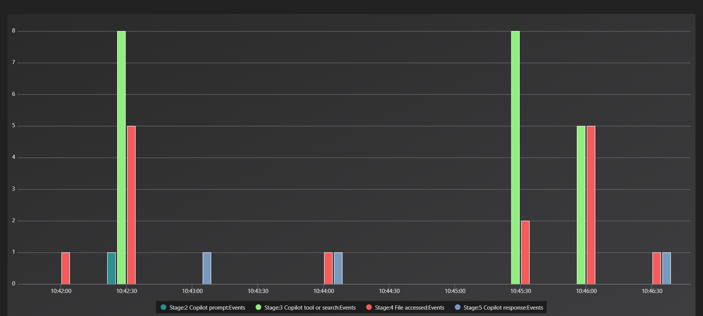

# Timeline: Operation ECHOLEAK

All times UTC, 20 September 2026. The Defender portal displays local time by default (PDT, UTC-7 when this was worked). Converted here: portal "2:15 AM" = 09:15 UTC.

Source for every row unless stated: Q0.4 merged victim timeline.

| # | Time (UTC) | Identity | Table | What happened | Evidence | Framework ID | Class | Confidence | Screenshot |
|---|------------|----------|-------|---------------|----------|--------------|-------|------------|------------|
| 1 | 09:15:22 | emily.chen | OfficeActivity | External email received. Sender `quarterly.reports@globalfinancereview.net`, subject "Q3 2026 Global Markets Review - For Your Analysis", attachment `Q3-2026-Global-Markets-Review.docx` | Q0.4, Q1.1 | T1566.001 | ATK | Confirmed | 03 |
| 2 | 09:15:31 | emily.chen | EntraSignIn | Sign-in success, Azure Portal, 203.0.113.45 London | Q0.4, Q7.1 | | NOISE (known IP) | Probable | 14 |
| 3 | 09:29:45 | emily.chen | EntraSignIn | Sign-in success, Outlook Mobile, 203.0.113.45 London | Q0.4 | | NOISE (known IP) | Probable | 14 |
| 4 | 10:24:11 | emily.chen | OfficeActivity | Routine marketing email (hubspot weekly analytics) | Q0.4 | | NOISE | Probable | |
| 5 | 10:42:08 | emily.chen | OfficeActivity | **First interaction with the lure**: FileAccessed on her OneDrive copy `personal/emily_chen_cormorantcapital_com/Documents/Q3-2026-Global-Markets-Review.docx` | Q0.4 | | ATK (victim action) | Confirmed | 05 |
| 6 | 10:42:35 | emily.chen | CopilotAudit | Prompt: "Summarise the key findings of this quarterly report" on the lure document. Session `cp-emily-20261007-1042` | Q0.4, Q3.3 | | ATK (trigger) | Confirmed | 07 |
| 7 | 10:42:41 to 10:42:45 | Copilot as emily.chen | CopilotAudit | 3 x Graph.SearchFiles: "board minutes confidential", "M&A acquisition target", "salary review confidential". None of these terms are in her prompt | Q0.4, Q4.1 | AML.T0051.001 | ATK | Confirmed | 08 |
| 8 | 10:42:47 to 10:42:55 | Copilot as emily.chen | CopilotAudit + OfficeActivity | 5 x Graph.ReadFile, each matched by a FileAccessed at the same second: Executive/Board Meeting Minutes - October 2026.docx; Executive/Project Falcon - M&A Target Assessment.xlsx; HR/Salary Review FY2027 - Executive Summary.pdf; Finance/Client Portfolio - Henderson Family Office.xlsx; IT/Copilot System Configuration - Cormorant.json. **This is the alert burst** | Q0.4, Q5.1 | T1213.002, AML.T0057 | ATK | Confirmed | 09 |
| 9 | 10:43:08 | Copilot | CopilotAudit | Response 1: a plausible market summary followed by a "Charts" section with 4 Markdown images (``). Each `d=` value is base64 of stolen content: "Board Meeting Minu...", "Project Falcon - M...", "Salary Review FY2027 ...", "Client Portfolio - ...". Inline image syntax, not reference-style | Q6.1 | T1567, AML.T0057 | ATK | Confirmed | 11 |
| 10 | 10:44:15 | emily.chen | OfficeActivity | FileAccessed on `Copilot System Configuration - Cormorant.json` again, with **no matching Copilot ToolCall** before it. Same ClientIP 203.0.113.45 as everything else (Q5.4), so the source cannot be determined from these logs | Q0.4, Q5.4 | | UNK | Possible | |
| 11 | 10:44:19 | Copilot | CopilotAudit | Response 2, no new user prompt. One exfil image URL, `s=config`, decoding to `system_prompt_cormorant_capital`: the Copilot system prompt / configuration (CoSnitch pattern) | Q6.4 | AML.T0057 | ATK | Confirmed | 12 |
| 12 | 10:45:30 to 10:45:45 | Copilot as emily.chen | CopilotAudit | 5 x Search with broad terms: "confidential", "restricted", "board", "acquisition", "salary" | Q0.4, Q9.3 | T1083 | ATK | Confirmed | 16.2 |
| 13 | 10:45:46 to 10:46:30 | Copilot as emily.chen | CopilotAudit + OfficeActivity | 8 more Graph.ReadFile + FileAccessed: Finance/Compliance Audit Results - H2 2026.xlsx; Finance/Restricted Client List - Internal Only.docx; Finance/Board Resolution - Emergency Session.pdf; Finance/Acquisition Pipeline - Q4 2026.xlsx; HR/Executive Salary Benchmarking 2027.pdf; HR/Confidential Investigation - Insider Trading.docx; Executive/Board Committee Minutes - Audit Committee.docx; Executive/Quarterly Revenue Report - Restricted Distribution.xlsx | Q0.4 | T1213.002, AML.T0057 | ATK | Confirmed | 09 |
| 14 | 10:46:35 | Copilot | CopilotAudit | Response 3, no new user prompt. Eight exfil image URLs, `s=sl1` to `s=sl8`, one per wave 2 file (SearchLeak pattern) | Q6.4 | T1567, AML.T0057 | ATK | Confirmed | 12 |
| 15 | 10:59:45 | emily.chen | OfficeActivity | MessageSent "Reminder: All-Hands Meeting Friday", no attachments, IP 203.0.113.45 | Q6.5 | | NOISE | Probable | 13 |

Class values: ATK, ADMIN, NOISE, UNK.

## Key intervals

| Interval | Value |
|----------|-------|
| Email delivered (09:15:22) to first interaction with the document (10:42:08) | **1 h 26 min 46 s (86.8 min; KQL `datetime_diff("minute")` returns 87)** |
| Email delivered to Copilot prompt (10:42:35) | 1 h 27 min 13 s |
| Document opened to Copilot prompt | 27 s |
| Prompt to first injected search (10:42:41) | 6 s |
| Prompt to first sensitive file read (10:42:47) | 12 s |
| Wave 1 file reads (alert burst) | 5 files, 10:42:47 to 10:42:55 |
| Wave 2 file reads | 8 files, 10:45:46 to 10:46:30 |
| All Copilot tool activity in the session | 10:42:41 to 10:46:30 (3 min 49 s) |
| Distinct sensitive files read | 13 (5 + 8), plus a second access to the config file |

## Timeline visual

*Events per 30 seconds for emily.chen, 10:40 to 10:48 UTC. Teal: Copilot prompt. Green: Copilot tool calls and searches. Red: FileAccessed. Blue: Copilot responses. One prompt at 10:42:35 is followed by two machine-speed waves of searches and file reads (10:42:30 bin and 10:45:30 to 10:46:00 bins), each closed by a response carrying exfiltration image URLs. The single red bar at 10:42 is Emily opening the lure document; the red and blue pair at 10:44 is the config re-access and the CoSnitch response.*
